# Rowpine

**Pivot tables, a pivot designer, and Excel and PDF export for TanStack Table and shadcn/ui data tables.**

[](https://www.npmjs.com/package/rowpine)
&nbsp;[Website](https://rowpine.com) · [Demos](https://rowpine.com/examples/) · [Docs](https://rowpine.com/docs/) · [Pricing](https://rowpine.com/pricing.html)

TanStack Table can group rows, but it has no pivot, and exporting means writing your own column mapping. Rowpine adds both and works from the table instance you already have: your columns, filters and shadcn/ui styling stay as they are.

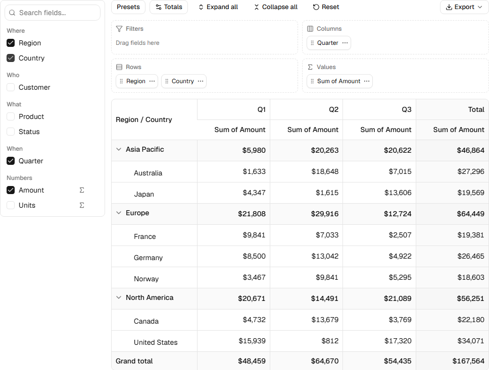

## Install

```bash
npm install rowpine
npx shadcn add https://rowpine.com/r/export-menu.json
npx shadcn add https://rowpine.com/r/pivot.json
```

The first line is the engine (file writers and pivot). The other two copy the export menu, the pivot table and the pivot designer into your project as source, so they pick up your theme. Works with TanStack Table v8 (`useReactTable`) and v9 (`useTable`), and with shadcn/ui on Base UI or Radix.

## Export what the user sees

```tsx
import { ExportMenu } from "@/components/export-menu"

<ExportMenu table={table} fileName="orders" />
```

The file follows the screen: visible columns in their order, every filtered row on every page, the current sort, pinned columns frozen. Grouped rows become Excel outline rows, and group totals are `SUBTOTAL` formulas over the rows below them, so they update when someone edits the sheet.

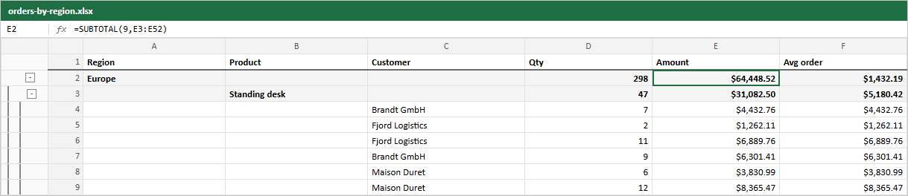

Numbers and dates are typed cells with real number formats, and the color rules you use on screen color the cells in the file:

```ts
helper.accessor("amount", {
  cell: (c) => money.format(c.getValue()),
  meta: { rowpine: { numFmt: '"$"#,##0.00', cellStyle: (v) => ((v as number) < 0 ? { color: "#b91c1c" } : undefined) } },
})
```

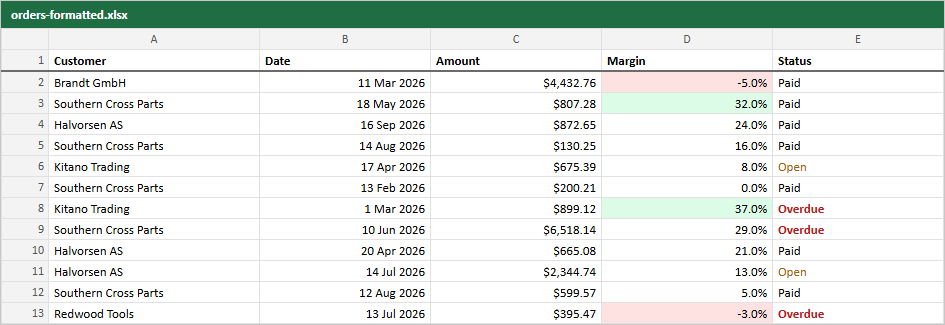

## PDF reports

`exportPdf` lays the table out on pages with the header row repeated, group rows bold with their totals, and a page footer. Add a title, headline numbers and a watermark, and pick the page size; wide tables shrink and then split so every column prints.

```ts
await exportPdf(table, {
  title: "Receivables",
  kpis: [{ label: "Invoiced", value: "$167,564.00" }],
  watermark: "DRAFT",
  pageSize: "LETTER",
  pageOrientation: "landscape",
})
```

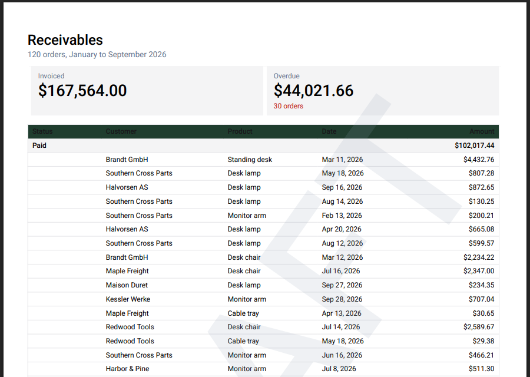

## Pivot tables

```tsx
import { PivotDesigner } from "@/components/pivot-designer"

<PivotDesigner data={orders} fields={fields} actions={(pivot) => <ExportMenu table={pivot.table} />} />
```

Users drag fields into Rows, Columns, Values and Filters, change aggregations (sum, average, min, max, count, distinct count, first, last, or your own function), filter values, load saved views and switch totals on and off. The layout is plain JSON you can store. For a pivot set up in code, `createPivot(data, config)` returns rows and TanStack column definitions you can render with your own table.

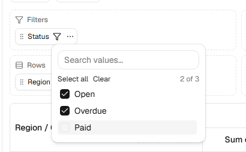

## Demos

Each demo plays a short story on the live component and ends with the exported file opened in the page. Pause it, jump to a step, or take over.

| | |
|---|---|
| [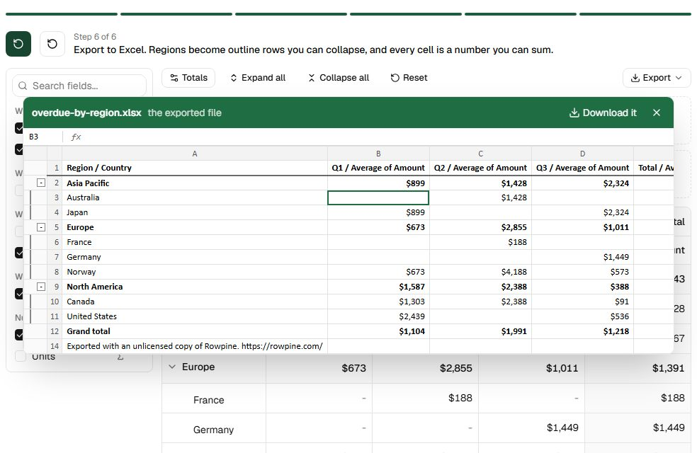](https://rowpine.com/examples/#/demo/sales-pivot)<br>**[Sales pivot](https://rowpine.com/examples/#/demo/sales-pivot)**: regions and countries by quarter, overdue only, to Excel | [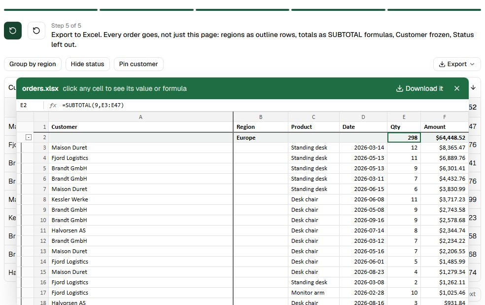](https://rowpine.com/examples/#/demo/orders-to-excel)<br>**[Orders to Excel](https://rowpine.com/examples/#/demo/orders-to-excel)**: sort, group, hide and pin, then export |
| [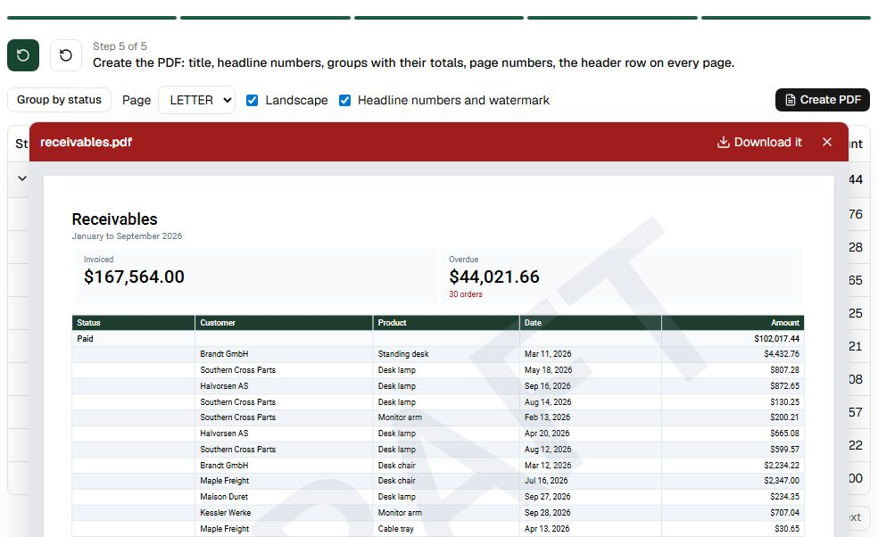](https://rowpine.com/examples/#/demo/month-end-pdf)<br>**[Month-end PDF](https://rowpine.com/examples/#/demo/month-end-pdf)**: receivables with headline numbers, Letter landscape | [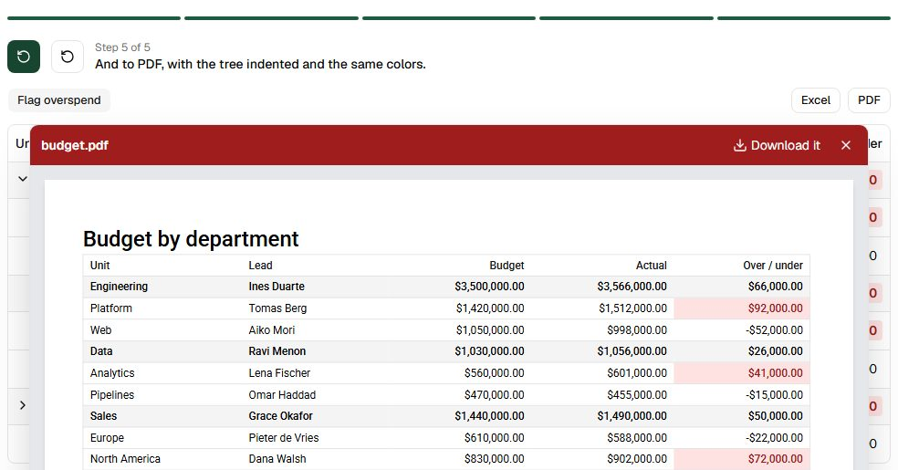](https://rowpine.com/examples/#/demo/budget-tree)<br>**[Budget by department](https://rowpine.com/examples/#/demo/budget-tree)**: a tree with overspend in red, to Excel and PDF |
| [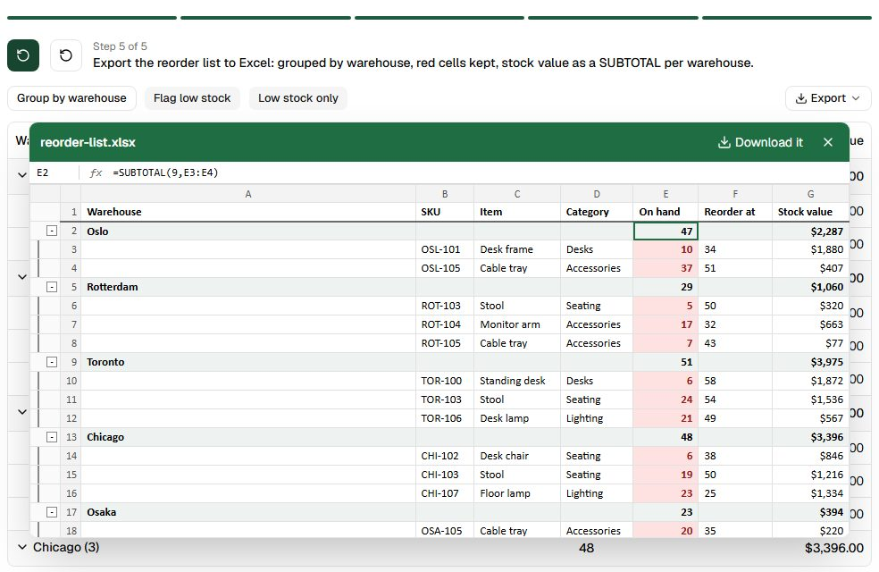](https://rowpine.com/examples/#/demo/inventory-reorder)<br>**[Inventory reorder list](https://rowpine.com/examples/#/demo/inventory-reorder)**: low stock flagged and kept, to Excel | [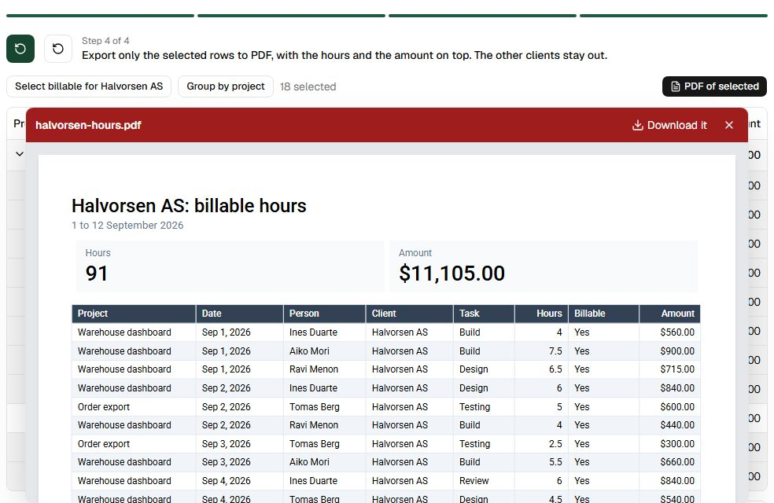](https://rowpine.com/examples/#/demo/timesheet-invoice)<br>**[Timesheet to invoice](https://rowpine.com/examples/#/demo/timesheet-invoice)**: one client's billable hours as a PDF |
| [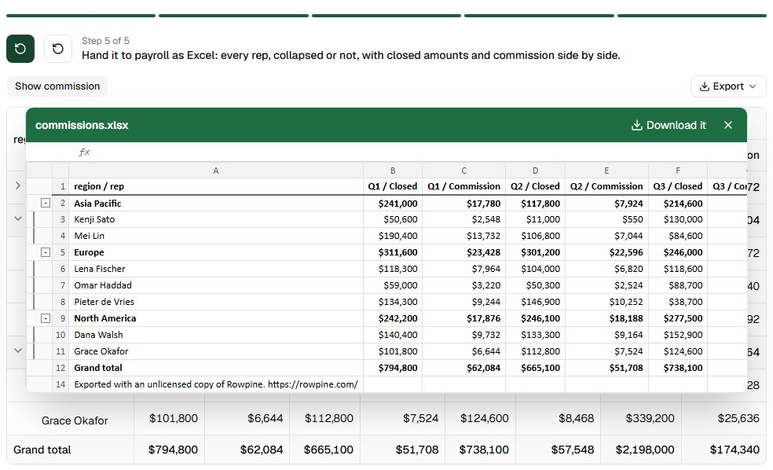](https://rowpine.com/examples/#/demo/sales-commissions)<br>**[Sales commissions](https://rowpine.com/examples/#/demo/sales-commissions)**: a tiered commission as a custom aggregation | [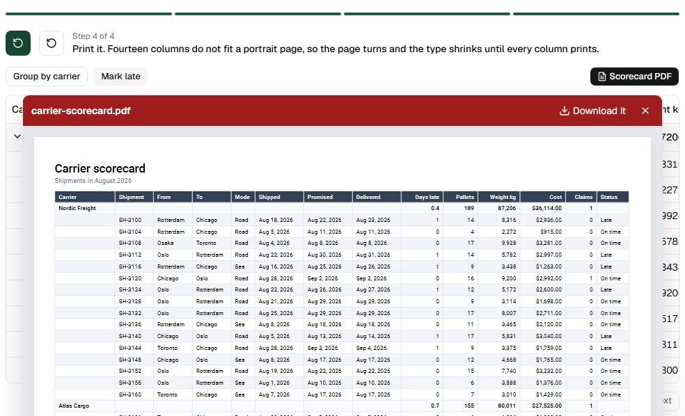](https://rowpine.com/examples/#/demo/carrier-scorecard)<br>**[Carrier scorecard](https://rowpine.com/examples/#/demo/carrier-scorecard)**: 14 columns fitted to a PDF page |
| [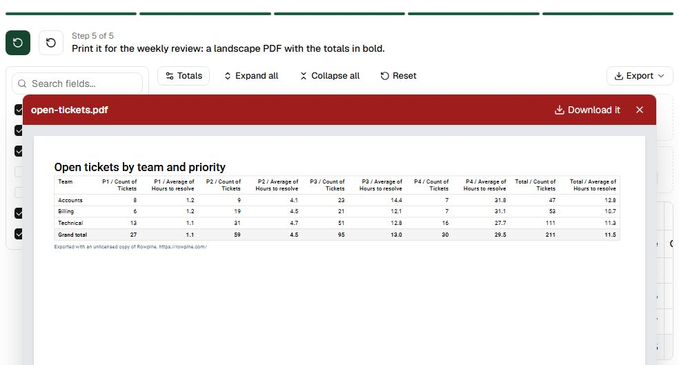](https://rowpine.com/examples/#/demo/support-tickets)<br>**[Support tickets](https://rowpine.com/examples/#/demo/support-tickets)**: open tickets by team and priority, printed | [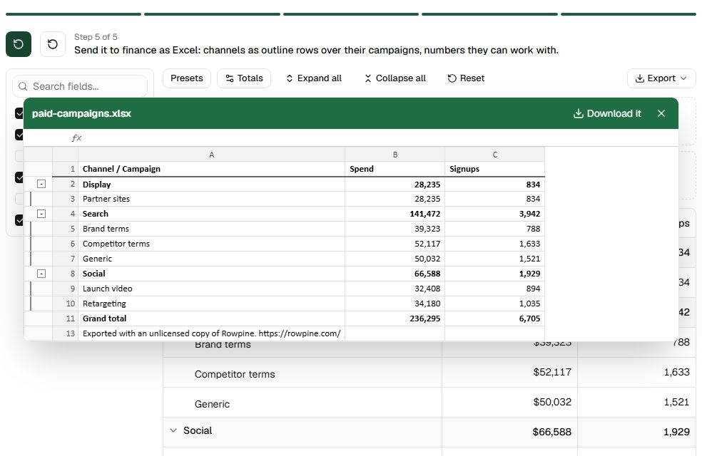](https://rowpine.com/examples/#/demo/marketing-spend)<br>**[Marketing spend](https://rowpine.com/examples/#/demo/marketing-spend)**: spend and signups by channel, a saved view |

There are also [16 feature examples](https://rowpine.com/examples/#/01-export-menu), one feature each with its source, and [30 help topics](https://rowpine.com/docs/).

## Pricing

CSV export is free. Pivots and Excel and PDF export come in one Pro license: $149 per developer or $499 for a team of up to 10, paid once, with a year of updates. You keep every version released in that year. Without a key everything still runs, and Excel and PDF files carry one notice line. See [pricing](https://rowpine.com/pricing.html) and the [license](https://rowpine.com/license.html).

## This repository

This repo holds the website at [rowpine.com](https://rowpine.com) and the shadcn registry: the pages in [`site/`](site/), the help topics in [`docs/`](docs/), the registry components in [`registry/`](registry/) (MIT) and their built items in [`site/r/`](site/r/). It deploys to GitHub Pages with [`.github/workflows/pages.yml`](.github/workflows/pages.yml).

```bash
npm install
npm run build:docs   # docs/*.md -> site/docs/*.html, a .md copy of each, and the docs list in site/llms.txt
npm run check        # every local link, image and script on every page resolves
```

Questions and bug reports: [open an issue](https://github.com/rowpine/rowpine/issues).

Rowpine is a brand of jQWidgets LTD. TanStack Table and shadcn/ui are separate projects and are not affiliated with Rowpine.
