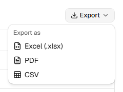

# Add an export menu



Pass the table you already render to `ExportMenu`. It works with the object `useReactTable` (v8) or `useTable` (v9) returns.

```tsx
import { ExportMenu } from "@/components/export-menu"

const table = useTable({ features, columns, data })

<ExportMenu table={table} fileName="orders" pdfTitle="Orders" />
```

The menu offers Excel, PDF and CSV. Each file holds what the user is looking at: the visible columns in their order, every row that passes the current filter (on every page, not just the one on screen), in the current sort, with groups in place.

## Props

| Prop | What it does |
|---|---|
| `table` | A TanStack table, or `pivot.table` from a pivot. |
| `fileName` | File name without the extension. Default `export`. |
| `pdfTitle` | Title printed at the top of the PDF. |
| `formats` | Which items to show, e.g. `["xlsx", "csv"]`. Default all three. |
| `rowStyle` | Style whole rows, e.g. `pivotRowStyle` for pivots. |
| `allowSelectedOnly` | Show "Selected rows only". Default: when rows are selected. |
| `onError` | Called if an export fails. Default `console.error`. |
| `label` | Button text. Default `Export`. |

The menu is plain source in your project. Change the icons, the labels or the button variant there.

Live example: https://rowpine.com/examples/#/01-export-menu
