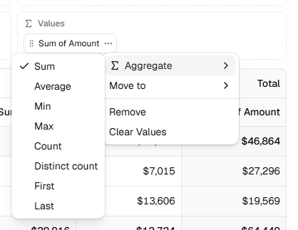

# Aggregations



Each value in a pivot has an aggregation:

| `agg` | Result |
|---|---|
| `sum` | Total of the numbers. |
| `avg` | Mean of the numbers. |
| `min`, `max` | Smallest and largest number. |
| `count` | Number of rows. |
| `countDistinct` | Number of different values. |
| `first`, `last` | The first or last value, in data order. |

Text that is not a number is skipped by `sum`, `avg`, `min` and `max`. A cell with no rows at all (no sales of a product in a quarter) is empty, not zero.

A function works too. It gets the values that fall in the cell:

```ts
const median = (values: readonly unknown[]) => {
  const n = values.map(Number).filter((v) => !Number.isNaN(v)).sort((a, b) => a - b)
  return n.length ? n[Math.floor(n.length / 2)] : null
}

values: [{ field: "amount", agg: median, label: "Median order" }]
```

In the [pivot designer](pivot-designer.html), users pick the aggregation from a value chip's menu. The same field can be in Values twice with different aggregations, such as sum and average of Amount.

Live example: https://rowpine.com/examples/#/09-pivot-designer
