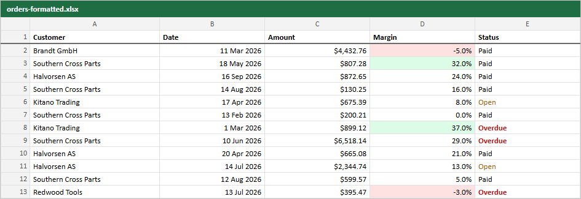

# Cell colors



`cellStyle` colors a cell in the Excel and PDF files. It gets the cell value and the row's original data and returns a fill, a text color and bold, or `undefined` for a plain cell.

```ts
const marginFill = (m: number) => (m < 0 ? "#fee2e2" : m >= 0.3 ? "#dcfce7" : undefined)

helper.accessor("margin", {
  cell: (c) => <span style={{ background: marginFill(c.getValue()) }}>{pct.format(c.getValue())}</span>,
  meta: { rowpine: { numFmt: "0.0%", cellStyle: (v) => ({ fill: marginFill(v as number) }) } },
})

helper.accessor("status", {
  meta: { rowpine: { cellStyle: (s) => (s === "Overdue" ? { color: "#b91c1c", bold: true } : undefined) } },
})
```

Use one function for the screen and the file, as above, so they cannot drift apart.

Colors are hex strings (`#rrggbb`). To style whole rows, such as a total row, pass `rowStyle` to the export or the menu:

```ts
<ExportMenu table={table} rowStyle={(o) => ((o as Order).status === "Overdue" ? { fill: "#fef2f2" } : undefined)} />
```

Live example: https://rowpine.com/examples/#/05-formats-colors
