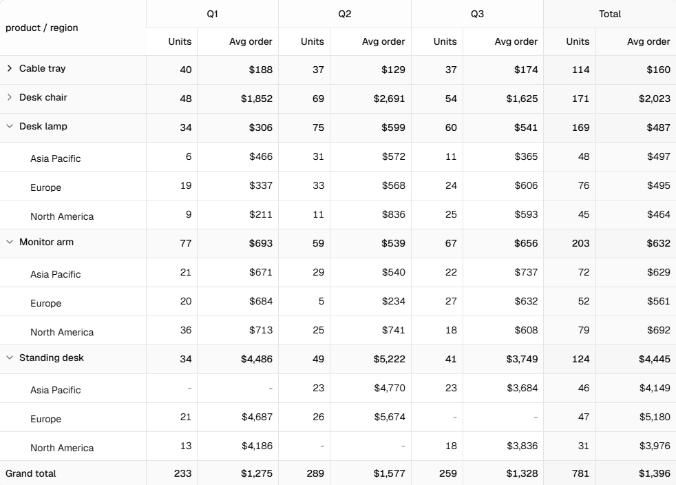

# Expand and collapse groups



Group rows in `PivotTable` have a chevron. Clicking it hides or shows the rows under the group. The group keeps its subtotal, so a collapsed pivot still adds up.

The table keeps its own state, or you can control it:

```tsx
import { expandableIds, PivotTable } from "@/components/pivot-table"

const [collapsed, setCollapsed] = useState<Set<string>>(new Set())

<button onClick={() => setCollapsed(expandableIds(pivot))}>Collapse all</button>
<button onClick={() => setCollapsed(new Set())}>Expand all</button>
<PivotTable pivot={pivot} collapsed={collapsed} onCollapsedChange={setCollapsed} />
```

`defaultCollapsed` starts an uncontrolled table with every group closed.

Collapsing is a view setting. Exports always hold every row, with groups as Excel outline rows the user can collapse in Excel.

Live example: https://rowpine.com/examples/#/08-pivot-table
