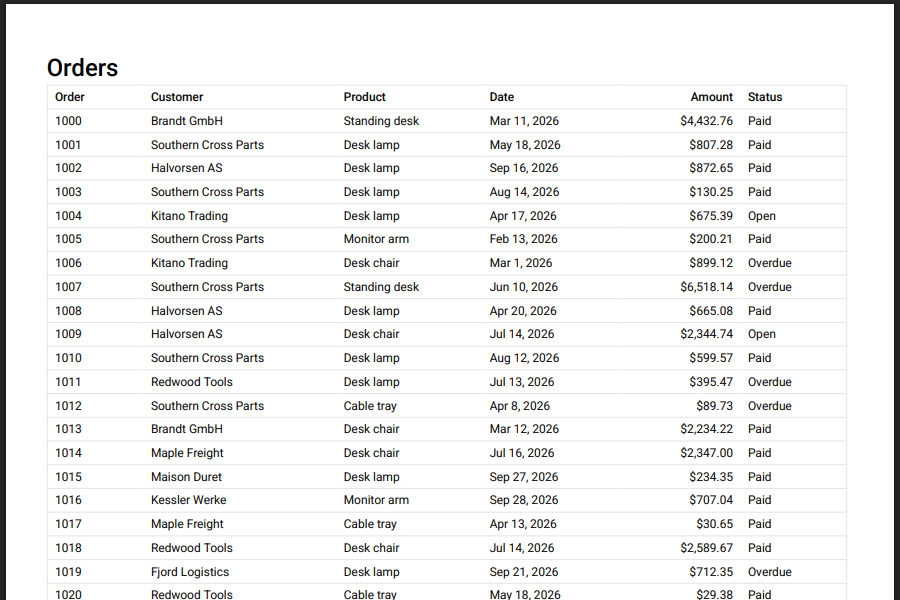

# Export to PDF



`exportPdf` lays the table out on pages: the header row repeats on every page, rows are separated by light lines, and the footer shows the date and "Page X of Y". The PDF looks like a shadcn/ui table: no header fill, no stripes, group rows in the muted gray. See [colors](#colors) to match your own theme.

```ts
import { exportPdf } from "rowpine"

await exportPdf(table, { fileName: "orders", title: "Orders" })
```

Wide tables fit the page: with more than 8 columns the page turns landscape, the text shrinks down to three quarters of its size if needed, and past that the columns split over several pages with the first column repeated. `fit` and `repeatColumns` change this; see [page setup](pdf-page-setup.html).

Cell text comes from each column's `meta.rowpine.format`, else numbers and dates in the browser's locale. See [number and date formats](number-and-date-formats.html).

## Languages

The default font, Roboto, has no Chinese, Japanese, Korean, Arabic, Hebrew, Thai or Indic letters. For those, pass a font that covers them and Latin:

```ts
await exportPdf(table, {
  font: { name: "Noto", normal: notoRegularBase64, bold: notoBoldBase64 },
})
```

Each file is the font's base64 data or a URL.

## Colors

`ExportMenu` reads your shadcn/ui theme from the page (`--foreground`, `--muted` and `--border`) and gives the PDF and Excel files the same colors as the table. Pass `theme="none"` to keep rowpine's defaults.

From your own buttons, read the theme with `exportThemeFromPage` and spread it into the options:

```ts
import { exportPdf, exportThemeFromPage, exportXlsx } from "rowpine"

const theme = exportThemeFromPage()
await exportPdf(table, { ...theme.pdf, title: "Orders" })
await exportXlsx(table, { ...theme.xlsx, fileName: "orders" })
```

A dark theme is not copied: files print on white, so the light defaults read better. Any color option you pass, such as `headerColor`, wins over the theme. See [PDF page setup](pdf-page-setup.html) for the full list.

Live example: https://rowpine.com/examples/#/01-export-menu
