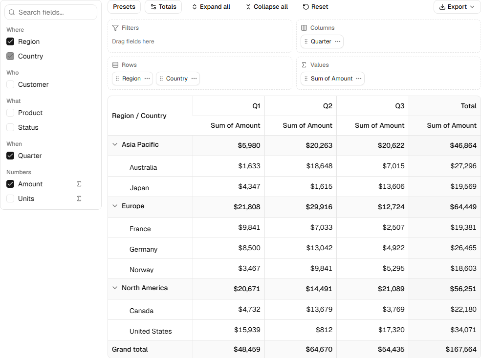

# Fields and wells



Users move fields in three ways:

- **Drag** a field from the list into a well, or a chip from one well to another. Dragging a chip back to the field list removes it.
- **Tick** a field in the list to add it to its default well (Rows for a dimension, Values for a measure). Untick it to remove it from every well.
- **Menus**: a field's `...` menu adds it to a well, and a chip's `...` menu moves it, removes it, or clears the well. These work from the keyboard.

A field appears once in Rows, Columns and Filters together; adding it to one well moves it out of the others. In Values the same field can appear more than once with different aggregations, but not twice with the same one.

The order of chips in Rows and Columns is the nesting order: the first chip is the outer group.

All of this is plain state. The functions the designer uses are exported, so you can drive the layout from your own UI:

```ts
import { addToWell, removeFromWell, setAggregatorAt, toggleField } from "rowpine"

setLayout((l) => addToWell(l, fields, "quarter", "cols"))
```

Live example: https://rowpine.com/examples/#/09-pivot-designer
