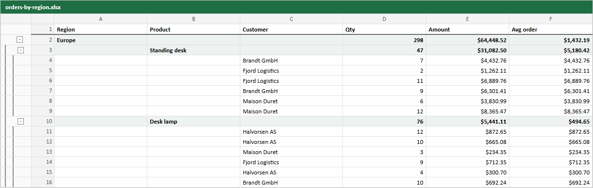

# Grouped rows become Excel outlines



When the table is grouped with TanStack's grouping feature, the file keeps the groups.

- Each group row is written with its label and its aggregates, bold, on a light fill.
- The rows under it get an Excel outline level, one per grouping level. The bars and minus buttons on the left of the image are Excel's: users can collapse a region or a product there.
- Group rows sit above their rows, as on screen.

```ts
const table = useTable({
  features,
  columns,
  data,
  initialState: { grouping: ["region", "product"], expanded: true },
})
```

Collapsed groups on screen are still exported in full. Collapsing is a view setting; the file always has every row, and the user collapses it in Excel.

A grouped-by value appears once, on its own group row, as on screen: the product group rows and the order rows leave the Region cell empty.

Live example: https://rowpine.com/examples/#/02-grouped-export
