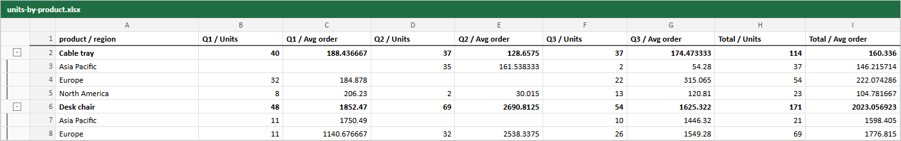

# Headers and column widths

The header row is built from your column definitions:

- A string `header` is used as is.
- A function `header` cannot be written to a file, so set `meta.rowpine.header`; otherwise the column id is used.
- Columns inside header groups get the group names joined with ` / `. In the image, the pivot's `Units` column under the `Q1` group becomes `Q1 / Units`. One header row keeps the sheet easy to filter and sort.

Column widths come from TanStack's column sizes (`size` in the column definition, or the width after the user resizes). Set `meta.rowpine.width` (pixels) to give the file a different width than the screen.

Live example: https://rowpine.com/examples/#/08-pivot-table
