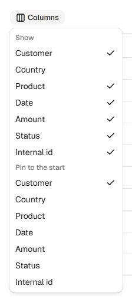

# Hidden and excluded columns



The file has the columns the user can see, in the order they see them.

- A column hidden with TanStack's column visibility is left out. In the image, Country is hidden, so the file has no Country column.
- Columns pinned to the start come first, then the rest, then columns pinned to the end, as on screen.
- Display columns, the ones without an accessor such as selection checkboxes and row actions, are left out: they have no value to write.
- A column with `exclude: true` never goes to a file, even when it is visible. Use it for internal ids and other data columns that should stay on screen only:

```ts
helper.accessor("id", { header: "Internal id", meta: { rowpine: { exclude: true } } })
```

`exclude: false` keeps a display column in the file.

If a column's `header` is a function (an icon, a sort button), set the file's header text with `meta.rowpine.header`; otherwise the column id is used.

Live example: https://rowpine.com/examples/#/03-columns
