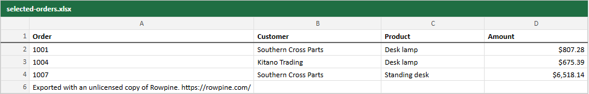

# License keys



Excel export, PDF export and pivots need a license. CSV export is free.

Set your key once, before the first export:

```ts
import { setLicenseKey } from "rowpine"

setLicenseKey(import.meta.env.VITE_ROWPINE_KEY)
```

## Without a key

Nothing is blocked. Exports and pivots work, the Excel and PDF files carry one notice line at the end (the image shows it on row 6), and the browser console logs a message once per page load.

## How a key works

A key is checked in the browser against a public key in the package. It never calls a server.

A key covers every Rowpine version released during its year of updates, and keeps working with those versions for good. A version released after the update year still runs; it shows the notice until you renew. To check what a key covers:

```ts
import { getLicenseStatus } from "rowpine"

const status = await getLicenseStatus()
// { licensed: true, payload: { sub, plan, seats, upd, ... }, buildDate }
// or { licensed: false, reason: "missing" | "malformed" | "invalid" | "updates-ended", ... }
```

Keep the key out of public repositories. A Vite env variable or your server config both work.

Live example: https://rowpine.com/examples/#/04-selected-rows
