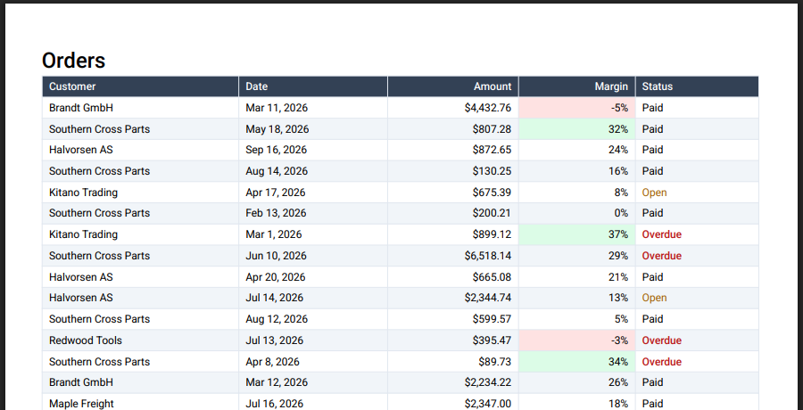

# Number and date formats



Excel and PDF need formats in different shapes, so a column can set both.

**Excel: `numFmt`.** An Excel number format code. The cell stays a number (or date) and Excel shows it formatted, so totals and filters still work.

```ts
meta: { rowpine: { numFmt: '"$"#,##0.00' } }   // $1,234.50
meta: { rowpine: { numFmt: "0.0%" } }           // 12.5% (store 0.125)
meta: { rowpine: { numFmt: "d mmm yyyy" } }     // 4 Mar 2026
```

Date columns default to `yyyy-mm-dd`. Without `numFmt` a number uses Excel's General format.

**PDF: `format`.** A PDF holds text, so give it the text you show on screen. Reusing the formatter your cell uses keeps the two the same:

```ts
const money = new Intl.NumberFormat("en-US", { style: "currency", currency: "USD" })

helper.accessor("amount", {
  cell: (c) => money.format(c.getValue()),
  meta: { rowpine: { numFmt: '"$"#,##0.00', format: (v) => money.format(v as number) } },
})
```

Without `format`, the PDF shows numbers and dates in the browser's locale. Empty cells never reach `format`.

Live example: https://rowpine.com/examples/#/05-formats-colors
