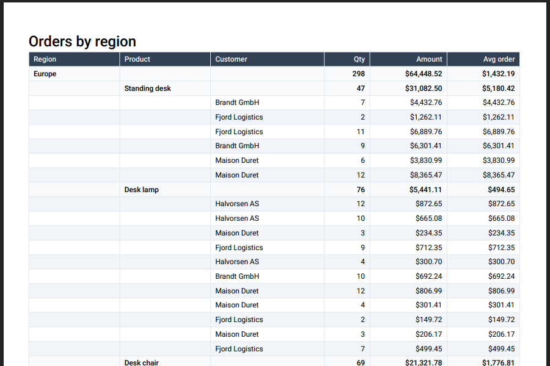

# Groups in a PDF



Grouped tables print their group rows bold on a light fill, with their aggregates, above the rows they group. Nested groups and tree rows are indented in the first column, one step per level.

The aggregate text uses the column's `format`, so a summed amount looks like the amounts under it:

```ts
helper.accessor("amount", {
  aggregationFn: "sum",
  aggregatedCell: (c) => money.format(c.getValue() as number),
  meta: { rowpine: { format: (v) => money.format(v as number) } },
})
```

Set the group row fill with `subtotalColor`:

```ts
await exportPdf(table, { subtotalColor: "#eef2f0" })
```

Live example: https://rowpine.com/examples/#/02-grouped-export
