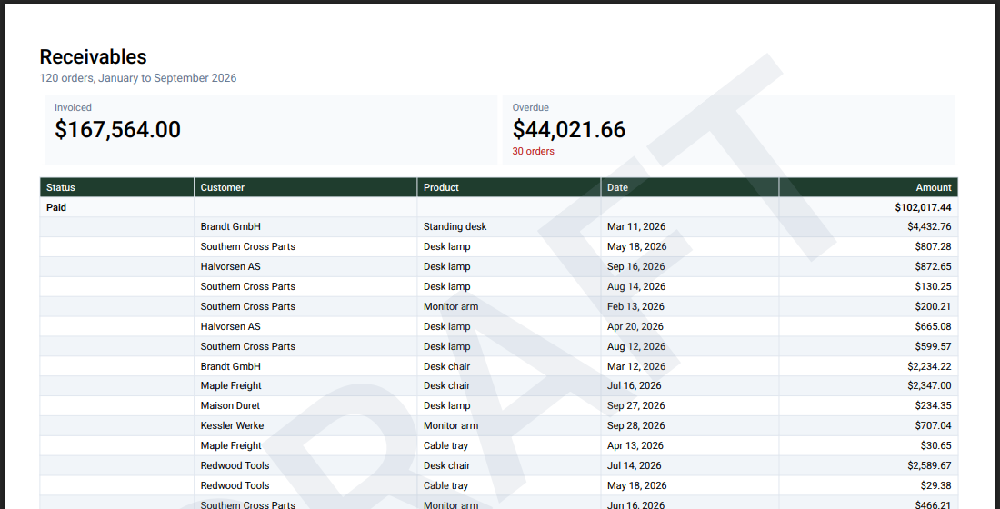

# PDF page setup



Page size, orientation, margins and how a wide table fits the page are all options of `exportPdf`.

```ts
await exportPdf(table, {
  pageSize: "LETTER",
  pageOrientation: "landscape",
  margins: [28, 34, 28, 34],
  fontSize: 8,
})
```

| Option | What it does |
|---|---|
| `pageSize` | `A4` (default), `A3`, `A5`, `LETTER`, `LEGAL`. |
| `pageOrientation` | `portrait` or `landscape`. Default: landscape past `autoLandscapeThreshold` columns (8). |
| `margins` | `[left, top, right, bottom]` in points. |
| `fontSize` | Base size in points. Default 8. |
| `columnWidths` | `"*"`, `"auto"`, or one entry per column (points, `"auto"` or `"*"`). |
| `fit` | `"auto"` (default): shrink, then split columns over pages. `"shrink"`, `"split"` or `"none"`. |
| `repeatColumns` | Columns repeated on every page when columns split. Default 1. |
| `repeatHeader` | Repeat the header row on every page. Default true. |
| `showPageNumbers` | The date and page footer. Default true. |
| `labels` | `{ page: (p, n) => string, date: (d) => string }` for another language. |

Colors: `headerColor`, `headerTextColor`, `zebra`, `zebraColor`, `textColor`, `borderColor`, and `subtotalColor` for group rows.

Live example: https://rowpine.com/examples/#/07-pdf-report
