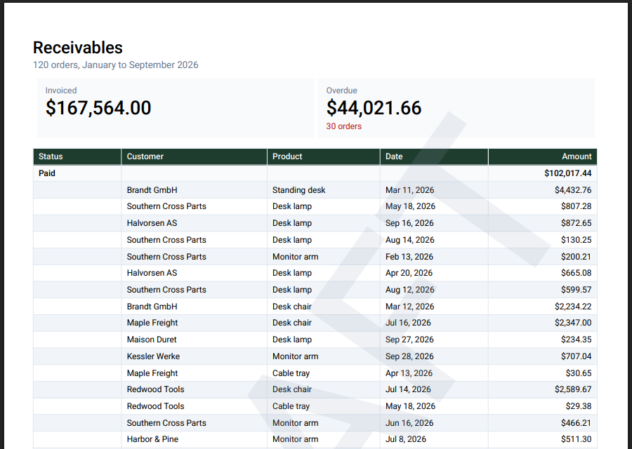

# Title, headline numbers and watermark



A PDF report usually needs more than the table. These options go above it:

```ts
await exportPdf(table, {
  title: "Receivables",
  subtitle: "120 orders, January to September 2026",
  kpis: [
    { label: "Invoiced", value: money.format(total) },
    { label: "Overdue", value: money.format(overdue), delta: "30 orders", color: "#b91c1c" },
  ],
  watermark: "DRAFT",
  headerColor: "#1f3d2e",
})
```

| Option | What it does |
|---|---|
| `title`, `subtitle` | Text above the table. The title also becomes the PDF's document title. |
| `logo`, `logoWidth` | An image data URL above the title, and its width in points (default 90). |
| `kpis` | A row of boxes: `label`, `value`, and an optional `delta` line in `color`. |
| `kpiColor` | Box fill. |
| `charts` | Images (data URLs) printed with the table: `{ image, title, caption, width }`. `chartsPosition`: `above` or `below`. |
| `watermark` | Large faint text on every page, or `{ text, color, opacity }`. |
| `author` | Stored in the PDF's properties. |

Live example: https://rowpine.com/examples/#/07-pdf-report
