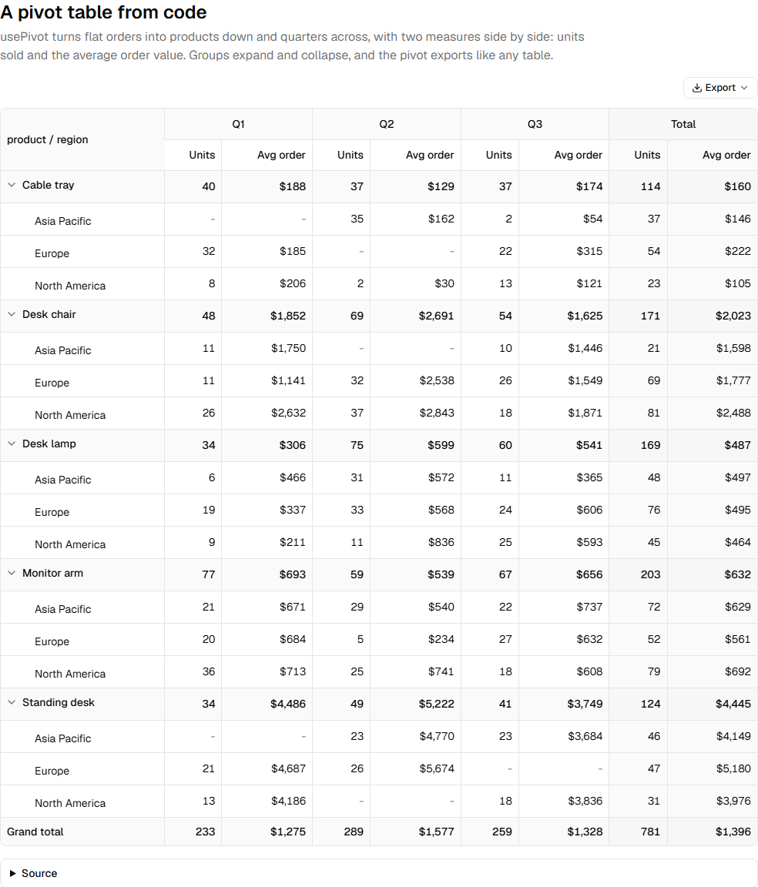

# Pivot tables



TanStack Table can group rows but has no pivot. Rowpine's pivot turns flat rows into a cross-tab: fields down the side, fields across the top, and aggregated values where they meet.

```tsx
import { PivotTable, usePivot } from "@/components/pivot-table"

const config: PivotConfig<Order> = {
  rows: ["product", "region"],
  cols: ["quarter"],
  values: [
    { field: "quantity", agg: "sum", label: "Units" },
    { field: "amount", agg: "avg", label: "Avg order", format: usd },
  ],
}

const pivot = usePivot(orders, config)
<PivotTable pivot={pivot} />
```

Keep `config` stable (module scope or `useMemo`); `usePivot` recomputes when it changes.

## Config

| Key | What it does |
|---|---|
| `rows` | Fields down the side, outermost first. |
| `cols` | Fields across the top, outermost first. |
| `values` | Measures: `field`, `agg`, `label`, `format`. Several measures sit side by side. |
| `rowHeader` | Header of the first column. Default: the row fields joined with ` / `. |
| `rowSubtotals` | Group rows carry subtotals. Default true. |
| `grandTotalRow`, `grandTotalCol` | Grand totals. Default true. |
| `rowSort`, `colSort` | `(a, b, level) => number` to order the values on an axis. Default: alphabetical, numbers in order. |

Without the registry component, `createPivot(data, config)` returns the same result: `data` (rows nested through `subRows`), `columns` (TanStack column definitions) and `table` (for exports). Render it with your own TanStack table if you prefer.

Live example: https://rowpine.com/examples/#/08-pivot-table
