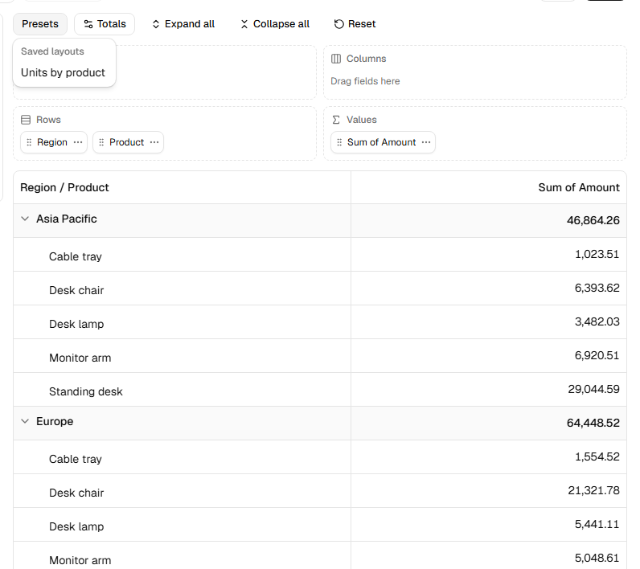

# Presets and saved views



A designer layout is plain JSON:

```json
{
  "rows": ["region", "country"],
  "cols": ["quarter"],
  "values": [{ "field": "amount", "agg": "sum", "label": "Sum of Amount" }],
  "filters": [{ "field": "status", "allowed": ["Overdue"] }],
  "hideSubtotals": false,
  "hideGrandTotals": false
}
```

Pass layouts as `presets` and they appear in the Presets menu:

```tsx
const presets = [{ name: "Revenue by region and quarter", layout: revenueLayout }]

<PivotDesigner data={orders} fields={fields} presets={presets} />
```

To let users save their own views, control the layout and store it wherever your app keeps settings: localStorage, your database, the URL.

```tsx
const [layout, setLayout] = useState(() => defaultLayoutFor(fields))
const [views, setViews] = useState<PivotPreset[]>(loadViews)

<PivotDesigner data={orders} fields={fields} layout={layout} onLayoutChange={setLayout} presets={views} />
<button onClick={() => saveViews([...views, { name, layout }])}>Save view</button>
```

The [saved views example](../examples/#/10-saved-layouts) keeps them in localStorage.

Live example: https://rowpine.com/examples/#/10-saved-layouts
