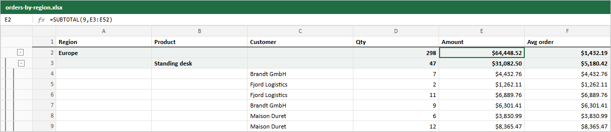

# Group totals as SUBTOTAL formulas

A group row's aggregates are written as live formulas over the rows below it, not as pasted numbers. If someone edits an amount in Excel, the group total updates.

In the image, Europe's amount is `=SUBTOTAL(9,E3:E52)`. The range includes the product group rows inside Europe, and `SUBTOTAL` skips other `SUBTOTAL` cells, so nothing is counted twice.

| Column `aggregationFn` | Formula |
|---|---|
| `sum` | `SUBTOTAL(9, ...)` |
| `mean` | `SUBTOTAL(1, ...)` |
| `min` | `SUBTOTAL(5, ...)` |
| `max` | `SUBTOTAL(4, ...)` |
| `auto` on a number column | `SUBTOTAL(9, ...)` |
| anything else | the value TanStack computed |

Each formula is saved with its result too, so viewers that do not recalculate (previews, some mobile apps) still show the right number.

Columns without a numeric aggregate are empty on group rows.

Live example: https://rowpine.com/examples/#/02-grouped-export
