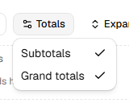

# Subtotals and grand totals



A pivot with more than one row field shows a subtotal on each group row, a Grand total row at the bottom and a Total column on the right.

```ts
const config = {
  rows: ["region", "country"],
  cols: ["quarter"],
  values: [{ field: "amount", agg: "sum" }],
  rowSubtotals: true,   // group rows carry their totals
  grandTotalRow: true,  // the Grand total row
  grandTotalCol: true,  // the Total column
}
```

With `rowSubtotals: false`, group rows stay (so groups still expand and collapse) but show no numbers, as in Excel.

The Total column only appears when there are column fields. Without any, the value columns already are the totals.

Totals are computed from the source rows, not by adding up the cells: an average's total is the average of all rows, not the average of the averages.

In the [pivot designer](pivot-designer.html), the Totals menu switches subtotals and grand totals on and off.

Live example: https://rowpine.com/examples/#/09-pivot-designer
