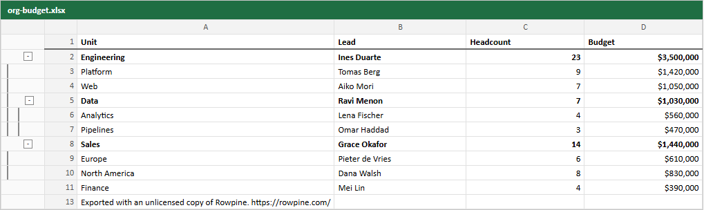

# Tree data in Excel

In Excel, tree rows get one outline level per depth. In the image, Platform, Web and Data are level 1 under Engineering, and Analytics and Pipelines are level 2 under Data. The minus buttons on parent rows collapse their children in Excel.

Excel shows up to 7 outline levels, so deeper trees are capped at level 7.

The last line of the image is the notice an unlicensed export carries; see [license keys](license-keys.html).

Live example: https://rowpine.com/examples/#/06-tree-data
