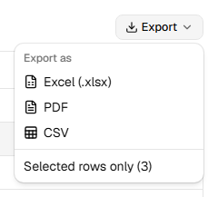

# Which rows are exported



By default an export holds every row that passes the table's filters, on every page, in the current sort. Paging is a screen concern; the file gets the whole result.

The `rows` option changes that:

| `rows` | Rows in the file |
|---|---|
| `"all"` (default) | Every filtered row, all pages, grouped and sorted as on screen. |
| `"page"` | Only the rows on the current page. |
| `"selected"` | Only the selected rows (needs TanStack's row selection). |

```ts
await exportXlsx(table, { rows: "selected" })
```

`ExportMenu` adds a "Selected rows only" checkbox when rows are selected. A selection column is usually a display column with checkboxes. Display columns have no accessor, so Rowpine leaves them out of the file on its own:

```ts
helper.display({ id: "select", cell: ... }) // not exported: no accessor
```

Live example: https://rowpine.com/examples/#/04-selected-rows
