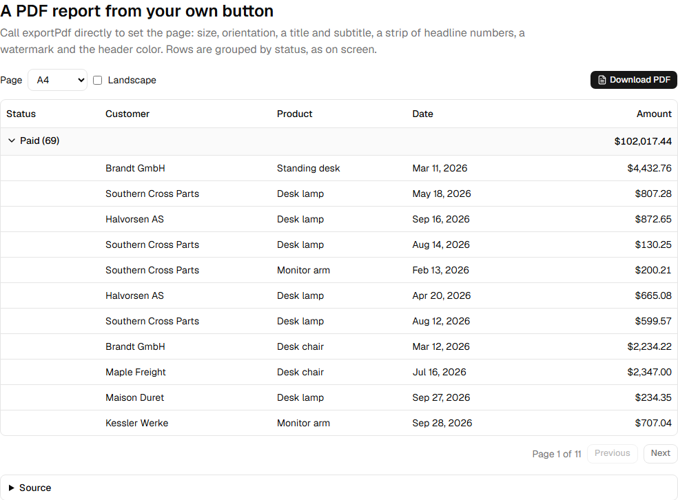

# Export from your own buttons



The export menu is optional. Call the export functions from any button, a keyboard shortcut or a scheduled job in the browser.

```ts
import { exportCsv, exportPdf, exportXlsx } from "rowpine"

await exportXlsx(table, { fileName: "orders" })
await exportPdf(table, { fileName: "orders", title: "Orders", pageOrientation: "landscape" })
await exportCsv(table, { fileName: "orders" })
```

Each returns the file as a `Blob` and, by default, saves it in the browser. Pass `download: false` to keep the Blob, for example to upload it or attach it to an email:

```ts
const blob = await exportXlsx(table, { download: false })
await fetch("/api/reports", { method: "POST", body: blob })
```

Options shared by all three:

| Option | What it does |
|---|---|
| `fileName` | File name; the extension is added. |
| `rows` | `"all"` (default), `"page"` or `"selected"`. See [which rows are exported](which-rows-are-exported.html). |
| `rowStyle` | `(original) => ({ fill, color, bold })` for whole rows. |
| `download` | Save the file. Default `true`. |

Live example: https://rowpine.com/examples/#/07-pdf-report
