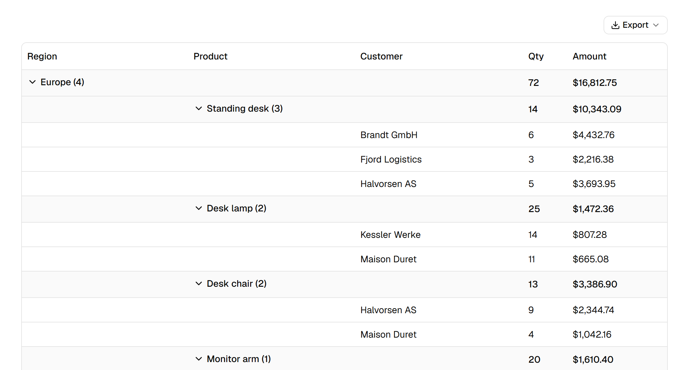
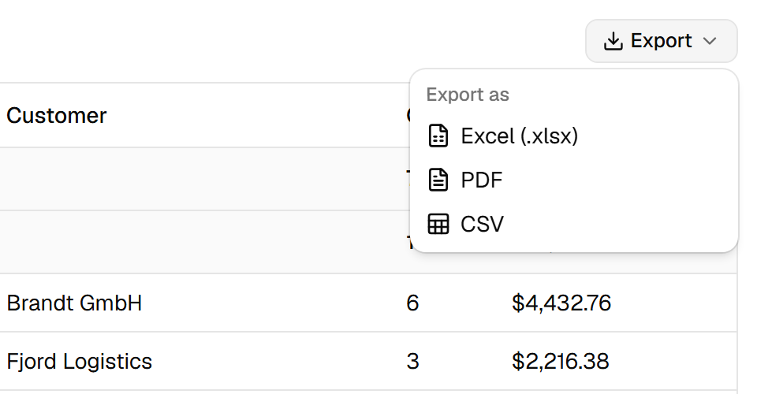

# Export TanStack Table to Excel with grouped rows

Group a TanStack Table by two columns and export it to a real .xlsx file where the groups are Excel outline levels and the group totals are SUBTOTAL formulas.

A grouped TanStack table is easy to read on screen: regions, products under them, a total on each group row. Export it with a CSV button and all of that is gone. The file has flat rows, no totals, and amounts stored as text.

This guide builds a table grouped by region and product, adds an Export menu, and gets you an Excel file that keeps the structure:

- each grouping level is an Excel outline level, so users collapse a region with Excel's own buttons;
- group totals are `SUBTOTAL` formulas, so they update when someone edits a number;
- amounts stay numbers with a currency format, so they sort and sum.

, and the bars on the left are Excel outline levels.")

The code uses TanStack Table v9 and shadcn/ui. The [last section](#tanstack-table-v8) shows the v8 version.

## Install

You need a React project with shadcn/ui and TanStack Table. Rowpine is the package that reads the table and writes the file; the export menu is a shadcn registry item, so its source lands in your project.

```bash
npm install rowpine @tanstack/react-table
npx shadcn add table
npx shadcn add @rowpine/export-menu
```

## The data

Any array of objects works. This guide uses orders with a region, a product, a customer, a quantity and an amount:

```ts title="orders.ts"
export type Order = {
  id: string
  region: string
  country: string
  customer: string
  product: string
  quarter: string
  quantity: number
  amount: number
}

export const orders: Order[] = [
  { id: "1001", region: "Europe", country: "Germany", customer: "Brandt GmbH", product: "Standing desk", quarter: "Q1", quantity: 6, amount: 4432.76 },
  { id: "1002", region: "Europe", country: "Germany", customer: "Kessler Werke", product: "Desk lamp", quarter: "Q1", quantity: 14, amount: 807.28 },
  // ...
]
```

## Register the grouping features

TanStack Table v9 only includes the features you register. Grouping needs three of them: `columnGroupingFeature` to group, `rowAggregationFeature` to compute the group totals, and `rowExpandingFeature` with the expanded row model to show the rows under each group. `columnVisibilityFeature` gives rows `getVisibleCells()` for rendering.

```tsx title="orders-table.tsx"
import {
  aggregationFn_sum,
  columnGroupingFeature,
  columnVisibilityFeature,
  createColumnHelper,
  createExpandedRowModel,
  createGroupedRowModel,
  metaHelper,
  rowAggregationFeature,
  rowExpandingFeature,
  tableFeatures,
  useTable,
} from "@tanstack/react-table"
import { ChevronDown, ChevronRight } from "lucide-react"
import type { RowpineColumnMeta } from "rowpine"

import { ExportMenu } from "@/components/export-menu"
import {
  Table,
  TableBody,
  TableCell,
  TableHead,
  TableHeader,
  TableRow,
} from "@/components/ui/table"
import { orders, type Order } from "./orders"
```

```tsx
const features = tableFeatures({
  columnVisibilityFeature,
  columnGroupingFeature,
  rowAggregationFeature,
  rowExpandingFeature,
  groupedRowModel: createGroupedRowModel(),
  expandedRowModel: createExpandedRowModel(),
  aggregationFns: { sum: aggregationFn_sum },
  // Types `meta.rowpine` on your columns.
  columnMeta: metaHelper<{ rowpine?: RowpineColumnMeta<Order> }>(),
})
```

The last line, `columnMeta`, is optional. It types `meta.rowpine` on your columns, where Rowpine reads its export settings.

## Define columns with aggregations

A column's `aggregationFn` decides what its group rows show. Rowpine turns it into the matching Excel function, so the file computes the same total the screen shows:

```tsx
const usd = new Intl.NumberFormat("en-US", { style: "currency", currency: "USD" })
const helper = createColumnHelper<typeof features, Order>()

const columns = helper.columns([
  helper.accessor("region", { header: "Region" }),
  helper.accessor("product", { header: "Product" }),
  helper.accessor("customer", { header: "Customer" }),
  helper.accessor("quantity", { header: "Qty", aggregationFn: "sum" }),
  helper.accessor("amount", {
    header: "Amount",
    aggregationFn: "sum",
    cell: (c) => usd.format(c.getValue()),
    aggregatedCell: (c) => usd.format(c.getValue() as number),
    // An Excel number format: the cell stays a number, shown as dollars.
    meta: { rowpine: { numFmt: '"$"#,##0.00' } },
  }),
])
```

| `aggregationFn` | Formula in Excel |
|---|---|
| `sum` | `SUBTOTAL(9, ...)` |
| `mean` | `SUBTOTAL(1, ...)` |
| `min` | `SUBTOTAL(5, ...)` |
| `max` | `SUBTOTAL(4, ...)` |
| anything else | the value TanStack computed |

`numFmt` is an Excel number format. The cell holds the number `4432.76` and Excel shows `$4,432.76`. Without it, the number is written plain; it is still a number either way, so it sorts and sums.

## Group the table and add the menu

`initialState.grouping` sets the grouping columns, outermost first. `expanded: true` opens every group. The export menu takes the table instance and nothing else:

```tsx
export function OrdersTable() {
  const table = useTable({
    features,
    columns,
    data: orders,
    initialState: { grouping: ["region", "product"], expanded: true },
  })

  return (
    <div className="grid gap-3">
      <div className="flex justify-end">
        <ExportMenu table={table} fileName="orders" pdfTitle="Orders" />
      </div>
      <div className="rounded-md border">
        <Table>
          <TableHeader>
            {table.getHeaderGroups().map((group) => (
              <TableRow key={group.id}>
                {group.headers.map((header) => (
                  <TableHead key={header.id}>
                    <table.FlexRender header={header} />
                  </TableHead>
                ))}
              </TableRow>
            ))}
          </TableHeader>
          <TableBody>
            {table.getRowModel().rows.map((row) => (
              <TableRow key={row.id} className={row.getIsGrouped() ? "bg-muted/50 font-medium" : undefined}>
                {row.getVisibleCells().map((cell) => (
                  <TableCell key={cell.id}>
                    {cell.getIsGrouped() ? (
                      <button type="button" onClick={row.getToggleExpandedHandler()} className="inline-flex items-center gap-1">
                        {row.getIsExpanded() ? <ChevronDown className="size-4" /> : <ChevronRight className="size-4" />}
                        <table.FlexRender cell={cell} /> ({row.subRows.length})
                      </button>
                    ) : cell.getIsPlaceholder() ? null : (
                      <table.FlexRender cell={cell} />
                    )}
                  </TableCell>
                ))}
              </TableRow>
            ))}
          </TableBody>
        </Table>
      </div>
    </div>
  )
}
```



The menu offers Excel, PDF and CSV. Pick Excel and the browser saves `orders.xlsx`.



## What lands in the file

Open the file in Excel:

- **Outline levels.** The rows under each region are at outline level 1 and the orders under each product at level 2. Excel draws the bars and minus buttons on the left; clicking one collapses the group.
- **Group rows above their rows,** bold, on a light fill, as on screen. A grouped-by value appears once, on its group row, so the order rows leave the Region and Product cells empty.
- **Formulas, not pasted numbers.** Europe's amount is `=SUBTOTAL(9,E3:E14)`. The range includes the product group rows inside Europe, and `SUBTOTAL` skips other `SUBTOTAL` cells, so nothing is counted twice. Each formula is saved with its result, so previews that do not recalculate still show the right total.
- **Every row.** The file holds every row that passes the table's filters, in the current sort, on every page. Groups collapsed on screen are exported in full; collapsing is a view setting, and the user can collapse them again in Excel.

> The group totals in the file are computed by Excel from the rows below them. If your users edit a quantity or amount in the sheet, the region and product totals follow.

## Export from your own button

The menu is optional. `exportXlsx` takes the same table and returns a promise:

```tsx title="excel-button.tsx"
import { exportXlsx, type TableLike } from "rowpine"

import { Button } from "@/components/ui/button"

export function ExcelButton({ table }: { table: TableLike }) {
  return (
    <Button
      variant="outline"
      onClick={() => exportXlsx(table, { fileName: "orders", sheetName: "Orders" })}
    >
      Download Excel
    </Button>
  )
}
```

Useful options:

| Option | What it does |
|---|---|
| `fileName` | File name without the extension. |
| `sheetName` | Worksheet name. Default `Sheet1`. |
| `rows` | `"all"` (default), `"page"` for the current page only, or `"selected"` for selected rows. |
| `groupFill` | Fill color of the group rows. The export menu uses your theme's muted color. |
| `download` | `false` to get the `Blob` back without saving it, for example to upload it. |

## TanStack Table v8

Rowpine reads v8 tables too. The setup differs in two places: row models are table options, and column meta is typed through module augmentation.

```tsx title="orders-table-v8.tsx"
import {
  createColumnHelper,
  getCoreRowModel,
  getExpandedRowModel,
  getGroupedRowModel,
  useReactTable,
  type RowData,
} from "@tanstack/react-table"
import type { RowpineColumnMeta } from "rowpine"

import { ExportMenu } from "@/components/export-menu"
import { orders, type Order } from "./orders"

// v8 types column meta through module augmentation.
declare module "@tanstack/react-table" {
  interface ColumnMeta<TData extends RowData, TValue> {
    rowpine?: RowpineColumnMeta<TData>
  }
}

const helper = createColumnHelper<Order>()
const columns = [
  helper.accessor("region", { header: "Region" }),
  helper.accessor("product", { header: "Product" }),
  helper.accessor("customer", { header: "Customer" }),
  helper.accessor("quantity", { header: "Qty", aggregationFn: "sum" }),
  helper.accessor("amount", {
    header: "Amount",
    aggregationFn: "sum",
    meta: { rowpine: { numFmt: '"$"#,##0.00' } },
  }),
]

export function OrdersTableV8() {
  const table = useReactTable({
    data: orders,
    columns,
    getCoreRowModel: getCoreRowModel(),
    getGroupedRowModel: getGroupedRowModel(),
    getExpandedRowModel: getExpandedRowModel(),
    initialState: { grouping: ["region", "product"], expanded: true },
  })

  return (
    <div>
      <ExportMenu table={table} fileName="orders" />
      {/* your table markup, unchanged */}
    </div>
  )
}
```

The file is the same: two outline levels and the same `SUBTOTAL` formulas.

## When something looks wrong

**A group row has an empty cell where a total should be.** The column has no numeric `aggregationFn`. Columns without one are left empty on group rows, the same as on screen.

**The header in the file is a column id.** The column's `header` is a function or JSX, which cannot be written to a file. Set `meta.rowpine.header` to the text you want.

**A column should stay on screen only.** Add `meta: { rowpine: { exclude: true } }` to it, for example an internal id. Checkbox and actions columns need nothing: columns without an accessor are left out on their own.

**Dates are text in Excel.** Only `Date` values become Excel dates. If your data has ISO strings, convert them in the accessor, `accessorFn: (r) => new Date(r.date)`, and set `numFmt: "yyyy-mm-dd"`.

## License

CSV export is free. Excel, PDF and pivot tables run without a key, with one notice line in each file; a [license](../pricing.html) removes it and is a one-time payment per developer with a year of updates. The live [Orders to Excel demo](../examples/#/demo/orders-to-excel) shows the same export with sorting, hidden columns and pinned columns.
