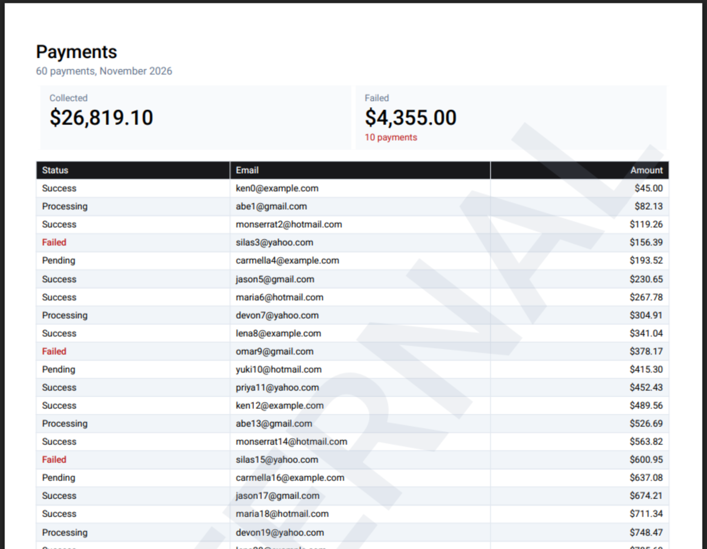
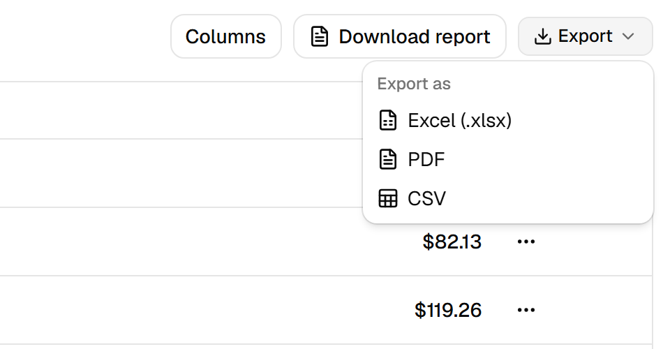
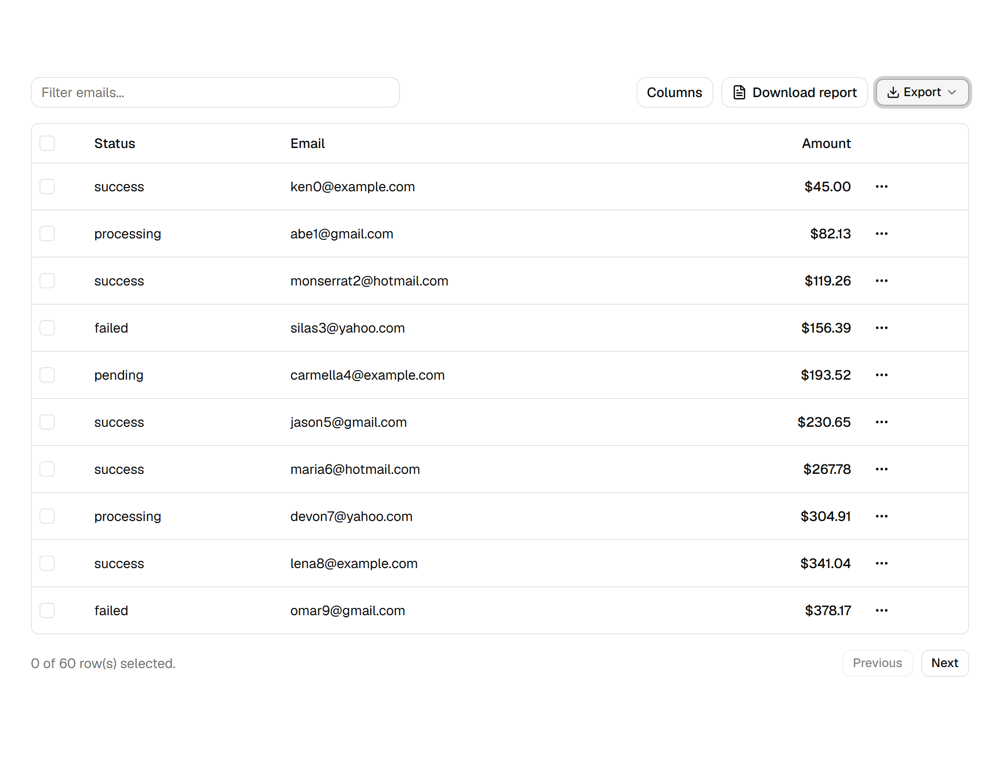

# shadcn data table export to PDF

Add PDF export to the shadcn/ui data table from the payments example, then turn it into a report with a title, headline numbers and a watermark.

The shadcn/ui [Data Table guide](https://ui.shadcn.com/docs/components/data-table) builds a payments table with TanStack Table: sorting, an email filter, a column toggle, row selection and pagination. It stops before export. This guide picks up there and adds:

- an Export menu with PDF, Excel and CSV;
- a "Download report" button that prints a title, headline numbers and a watermark above the table.



The files and names match the shadcn guide: `data-table-features.ts`, `columns.tsx`, `data-table.tsx` and the page. The shadcn guide uses TanStack Table v9, and so does this one; [v8 notes](#on-tanstack-table-v8) are at the end.

## Install

```bash
npm install rowpine
npx shadcn add https://rowpine.com/r/export-menu.json
```

`rowpine` builds the files in the browser. The export menu lands in `components/export-menu.tsx` as source, styled by your theme.

## Let columns carry export settings

Rowpine reads per-column settings from `meta.rowpine`. Add one line to the features object from the shadcn guide so TypeScript knows about them:

```ts title="data-table-features.ts"
import {
  columnFilteringFeature,
  columnVisibilityFeature,
  createFilteredRowModel,
  createPaginatedRowModel,
  createSortedRowModel,
  filterFn_includesString,
  metaHelper,
  rowPaginationFeature,
  rowSelectionFeature,
  rowSortingFeature,
  sortFn_alphanumeric,
  sortFn_text,
  tableFeatures,
} from "@tanstack/react-table"
import type { RowpineColumnMeta } from "rowpine"

export const features = tableFeatures({
  columnFilteringFeature,
  columnVisibilityFeature,
  rowPaginationFeature,
  rowSelectionFeature,
  rowSortingFeature,
  filteredRowModel: createFilteredRowModel(),
  paginatedRowModel: createPaginatedRowModel(),
  sortedRowModel: createSortedRowModel(),
  filterFns: { includesString: filterFn_includesString },
  sortFns: { alphanumeric: sortFn_alphanumeric, text: sortFn_text },
  // New: lets columns carry Rowpine's export settings in `meta.rowpine`.
  columnMeta: metaHelper<{ rowpine?: RowpineColumnMeta }>(),
})

export type DataTableFeatures = typeof features
```

The rest of the file is the shadcn guide's, unchanged.

## Set up the amount column

Most columns export as they are. `status` and `email` have string headers and plain values, and the select and actions columns are display columns with no accessor, so Rowpine leaves them out of the file on its own.

**The amount column** has a JSX header, which cannot be printed, and a cell that formats the number in JSX. Give the file a header and the text to print:

```tsx title="columns.tsx"
columnHelper.accessor("amount", {
  header: () => <div className="text-right">Amount</div>,
  cell: ({ row }) => {
    const formatted = usd.format(row.getValue("amount"))
    return <div className="text-right font-medium">{formatted}</div>
  },
  meta: {
    rowpine: {
      header: "Amount", // the header above is JSX, so name it for the file
      format: (v) => usd.format(v as number), // the text the PDF prints
    },
  },
}),
```

**The status column** is optional. Its values are lowercase; `format` capitalizes them in the PDF and `cellStyle` prints failed payments in bold red:

```tsx
meta: {
  rowpine: {
    format: (v) => String(v).charAt(0).toUpperCase() + String(v).slice(1),
    cellStyle: (v) => (v === "failed" ? { color: "#b91c1c", bold: true } : undefined),
  },
},
```

`format` only changes the text in the PDF and CSV. The table on screen renders as before.

## Add the export menu

In `data-table.tsx`, import the menu and put it in the toolbar next to the Columns button:

```tsx title="data-table.tsx"
import { ExportMenu } from "@/components/export-menu"

// in the toolbar, after the Columns dropdown
<ExportMenu table={table} fileName="payments" pdfTitle="Payments" />
```



Pick PDF and the browser saves `payments.pdf`. What it holds:

- **Every filtered row, not just the page.** The table shows 10 payments per page; the PDF has all 60. Type in the email filter first and the PDF has only the matches, in the current sort.
- **The visible columns, in order.** Hide a column with the Columns menu and it leaves the PDF too.
- **Selected rows, when asked.** Once rows are selected, the menu shows a "Selected rows only" option.
- **Pages that read on paper.** The header row repeats on every page, rows are striped, and the footer has the date and "Page 1 of 2".

## Turn it into a report

A report needs more than the table. `exportPdf` takes the same table plus options for the page. Give `DataTable` an optional `report` prop and a button that uses it:

```tsx title="data-table.tsx"
import * as React from "react"
import {
  useTable,
  type ColumnDef,
  type ColumnFiltersState,
  type ColumnVisibilityState,
  type RowData,
  type SortingState,
} from "@tanstack/react-table"
import { FileText } from "lucide-react"
import { exportPdf, type PdfTableExportOptions } from "rowpine"

import { ExportMenu } from "@/components/export-menu"
```

```tsx
interface DataTableProps<TData extends RowData> {
  columns: ColumnDef<DataTableFeatures, TData>[]
  data: TData[]
  /** Optional: a "Download report" button with these PDF options. */
  report?: PdfTableExportOptions
}
```

```tsx
// in the toolbar
{report && (
  <Button variant="outline" onClick={() => exportPdf(table, report)}>
    <FileText />
    Download report
  </Button>
)}
```

The page decides what goes on top. Here, the total collected and the failed payments, computed from the data:

```tsx title="page.tsx"
import { columns } from "./columns"
import { DataTable } from "./data-table"
import { payments } from "./payments"

const usd = new Intl.NumberFormat("en-US", { style: "currency", currency: "USD" })

export default function PaymentsPage() {
  const total = payments.reduce((sum, p) => sum + p.amount, 0)
  const failed = payments.filter((p) => p.status === "failed")

  return (
    <div className="container mx-auto py-10">
      <DataTable
        columns={columns}
        data={payments}
        report={{
          fileName: "payments-report",
          title: "Payments",
          subtitle: `${payments.length} payments, November 2026`,
          kpis: [
            { label: "Collected", value: usd.format(total) },
            {
              label: "Failed",
              value: usd.format(failed.reduce((sum, p) => sum + p.amount, 0)),
              delta: `${failed.length} payments`,
              color: "#b91c1c",
            },
          ],
          pageSize: "LETTER",
          headerColor: "#18181b",
          watermark: "INTERNAL",
        }}
      />
    </div>
  )
}
```



| Option | What it does |
|---|---|
| `title`, `subtitle` | Text above the table. The title is also the PDF's document title. |
| `kpis` | A row of boxes: `label`, `value`, and an optional `delta` line in `color`. |
| `watermark` | Large faint text on every page, or `{ text, color, opacity }`. |
| `pageSize` | `A4` (default), `A3`, `A5`, `LETTER` or `LEGAL`. |
| `pageOrientation` | `portrait` or `landscape`. Tables with more than 8 columns turn landscape on their own. |
| `headerColor` | Fill of the header row. |
| `logo` | An image data URL above the title. |
| `rows` | `"all"` (default), `"page"` or `"selected"`. |

Because the button passes the live table, the report follows the screen like the menu does: type in the email filter and the report lists only the matches.

## Wide tables and other languages

Past 8 columns the page turns landscape, the text shrinks down to three quarters of its size if needed, and after that the columns split across pages with the first column repeated. `fit` and `repeatColumns` change this; see [PDF page setup](../docs/pdf-page-setup.html).

The default font, Roboto, has no Chinese, Japanese, Korean, Arabic, Hebrew, Thai or Indic letters. For those, pass a font that covers them: [Export to PDF](../docs/export-to-pdf.html#languages) shows how.

## On TanStack Table v8

Older versions of the shadcn guide used `useReactTable`. Rowpine reads that table the same way: pass it to `ExportMenu` or `exportPdf` unchanged. The one difference is typing `meta.rowpine`, which v8 does through module augmentation:

```tsx title="tanstack.d.ts"
// v8 types column meta through module augmentation.
declare module "@tanstack/react-table" {
  interface ColumnMeta<TData extends RowData, TValue> {
    rowpine?: RowpineColumnMeta<TData>
  }
}
```

## If TypeScript rejects the table

With `rowpine` 1.0.1 and earlier, a v9 table without the grouping feature, like the shadcn one, fails to type-check with "not assignable to type TableLike", and checkbox and actions columns need `meta: { rowpine: { exclude: true } }`. Version 1.0.2 fixes both:

```bash
npm install rowpine@latest
```

## License

CSV export is free. PDF and Excel run without a key, with one notice line in each file; a [license](../pricing.html) removes it and is a one-time payment per developer with a year of updates. For a longer report, see the [Month-end PDF demo](../examples/#/demo/month-end-pdf): receivables grouped by status, headline numbers, Letter landscape.
