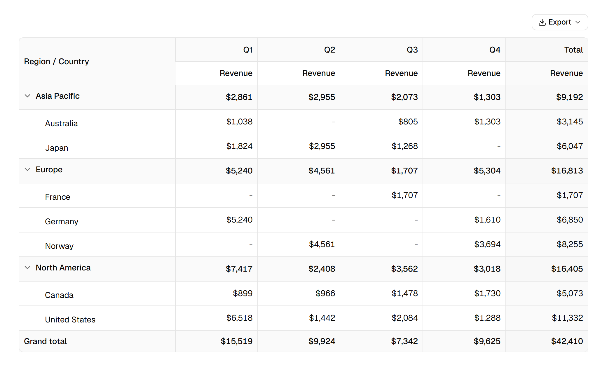
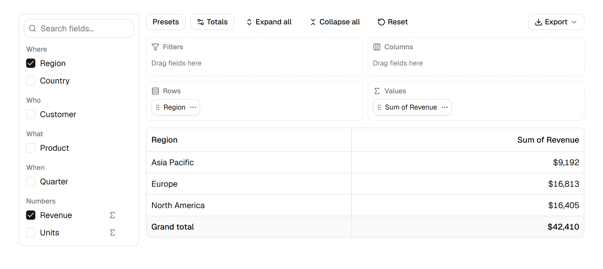
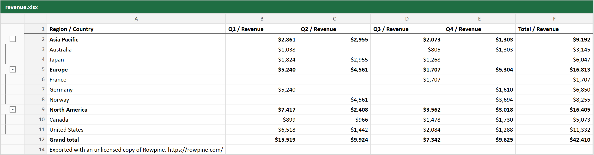

# TanStack Table pivot table

TanStack Table groups rows but has no pivot. Build one from code, let users design it with a field list and drop wells, and export it to Excel.

TanStack Table can group rows: regions, then countries under them, with a total on each group row. A pivot table goes one step further and spreads a field across the columns too. Revenue by region down the side and by quarter across the top is a pivot; TanStack has no feature for it.

Building one yourself means reading the distinct values of the column fields, generating a column definition for each combination of value and measure, aggregating every cell, and adding subtotal rows, a total column and a grand total. This guide does it with Rowpine instead, in three steps:

1. a pivot from code, rendered with a shadcn/ui table;
2. a designer where users drag fields into rows, columns and values themselves;
3. an Excel export of whatever pivot is on screen.



## Grouping or pivot?

| | TanStack grouping | Pivot |
|---|---|---|
| Rows | Grouped by one or more fields | Grouped by one or more fields |
| Columns | The columns you defined | Generated from the values of the column fields |
| Cells | Your row data, totals on group rows | Aggregated values at each row and column intersection |
| Totals | Per group row | Per row group, per column, and a grand total |

If your users ask "how much per region, per quarter", they want a pivot.

## Install

The `rowpine` package has the pivot engine. The `pivot` registry item installs two components into your project: `pivot-table.tsx` and `pivot-designer.tsx`. Add the export menu too for the last step.

```bash
npm install rowpine @tanstack/react-table
npx shadcn add @rowpine/pivot
npx shadcn add @rowpine/export-menu
```

The examples use orders with a region, country, customer, product, quarter, quantity and amount. Any array of objects works; the [Excel guide](export-tanstack-table-to-excel-with-grouped-rows.html#the-data) shows the data.

## A pivot from code

A pivot is a config: fields down the side (`rows`), fields across the top (`cols`), and the measures at each intersection (`values`). `usePivot` builds it, `PivotTable` renders it:

```tsx title="sales-pivot.tsx"
import { pivotRowStyle, type PivotConfig } from "rowpine"

import { ExportMenu } from "@/components/export-menu"
import { PivotTable, usePivot } from "@/components/pivot-table"
import { orders, type Order } from "./orders"

const usd = (v: unknown) =>
  typeof v === "number" ? `$${Math.round(v).toLocaleString("en-US")}` : ""

// Module scope keeps the config stable; usePivot recomputes when it changes.
const config: PivotConfig<Order> = {
  rows: ["region", "country"],
  cols: ["quarter"],
  values: [{ field: "amount", agg: "sum", label: "Revenue", format: usd }],
  rowHeader: "Region / Country",
}

export function SalesPivot() {
  const pivot = usePivot(orders, config, { numFmt: '"$"#,##0' })

  return (
    <div className="grid gap-3">
      <div className="flex justify-end">
        <ExportMenu table={pivot.table} fileName="revenue" pdfTitle="Revenue" rowStyle={pivotRowStyle} />
      </div>
      <PivotTable pivot={pivot} />
    </div>
  )
}
```

What each part does:

| Key | What it does |
|---|---|
| `rows` | Fields down the side, outermost first. Each one is a level you can expand and collapse. |
| `cols` | Fields across the top, outermost first. Each distinct value becomes a column group. |
| `values` | The measures: `field`, `agg`, `label` and an optional `format`. Several measures sit side by side under each column. |
| `rowHeader` | The header of the first column. Default: the row fields joined with ` / `. |
| `rowSubtotals` | Group rows carry subtotals. Default true. |
| `grandTotalRow`, `grandTotalCol` | The grand total row and the Total column. Default true. |

`agg` is one of `sum`, `avg`, `min`, `max`, `count`, `countDistinct`, `first` or `last`, or your own function from the values under a cell to the number to show. The [sales commissions demo](../examples/#/demo/sales-commissions) uses a custom one for a tiered commission.

Keep the config stable, at module scope or in `useMemo`. `usePivot` recomputes when the config changes, which is what you want when the user changes it and wasted work on every render otherwise.

The third argument, `{ numFmt: '"$"#,##0' }`, is the Excel number format for the value columns. It only affects exports.

## Let users build the pivot

A fixed pivot answers one question. The designer lets users ask their own: a field list on the left, four wells (Filters, Columns, Rows, Values), and the pivot under them.

```tsx title="sales-designer.tsx"
import { pivotRowStyle, type PivotField, type PivotPreset } from "rowpine"

import { ExportMenu } from "@/components/export-menu"
import { PivotDesigner } from "@/components/pivot-designer"
import { orders, type Order } from "./orders"

const usd = (v: unknown) =>
  typeof v === "number" ? `$${Math.round(v).toLocaleString("en-US")}` : ""

const fields: PivotField<Order>[] = [
  { field: "region", label: "Region", kind: "dimension", group: "Where" },
  { field: "country", label: "Country", kind: "dimension", group: "Where" },
  { field: "customer", label: "Customer", kind: "dimension", group: "Who" },
  { field: "product", label: "Product", kind: "dimension", group: "What" },
  { field: "quarter", label: "Quarter", kind: "dimension", group: "When" },
  { field: "amount", label: "Revenue", kind: "measure", group: "Numbers", format: usd },
  { field: "quantity", label: "Units", kind: "measure", group: "Numbers" },
]

const presets: PivotPreset[] = [
  {
    name: "Revenue by region and quarter",
    layout: {
      rows: ["region", "country"],
      cols: ["quarter"],
      values: [{ field: "amount", agg: "sum", label: "Revenue" }],
      filters: [],
    },
  },
  {
    name: "Units by product",
    layout: {
      rows: ["product"],
      cols: ["region"],
      values: [{ field: "quantity", agg: "sum", label: "Units" }],
      filters: [],
    },
  },
]

export function SalesDesigner() {
  return (
    <PivotDesigner
      data={orders}
      fields={fields}
      presets={presets}
      pivotOptions={{ numFmt: '"$"#,##0' }}
      actions={(pivot) => (
        <ExportMenu table={pivot.table} fileName="sales" rowStyle={pivotRowStyle} />
      )}
    />
  )
}
```



A field's `kind` decides where it can go: a `dimension` goes to Rows, Columns or Filters, a `measure` to Values or Filters. `group` sorts the field list under headings. On a value chip, users pick the aggregation from a menu.

`presets` fill the Presets menu with layouts you wrote. A layout is plain JSON (`rows`, `cols`, `values`, `filters`), so you can also save the user's layout with `onLayoutChange` and restore it later with `layout`: in local storage, in your database, or in the URL.

## Export the pivot to Excel

Both components give you `pivot.table`, a table view of the pivot for the exporters. Pass it to the export menu with `pivotRowStyle`, which makes the group, subtotal and grand total rows bold:

```tsx
<ExportMenu table={pivot.table} fileName="revenue" rowStyle={pivotRowStyle} />
```



In the file:

- The first column header is your `rowHeader`, and each value column joins its column group with the measure: `Q1 / Revenue`. One header row keeps the sheet easy to filter and sort.
- Row groups become Excel outline levels.
- The cells are numbers with the `numFmt` you passed, so they can be summed and charted.
- Every row is in the file, including groups collapsed on screen, and only the rows the designer's filters let through.

`exportXlsx(pivot.table, { rowStyle: pivotRowStyle })` does the same from your own button, and PDF and CSV work the same way.

## Render it with your own TanStack table

`PivotTable` is a regular shadcn/ui table. If you would rather use the table component you already have, `createPivot` returns everything TanStack needs: `data` (rows nested through `subRows`), `columns` (column definitions with header groups for the column fields) and `table` (for exports).

```tsx title="use-revenue-pivot-table.ts"
import * as React from "react"
import {
  createExpandedRowModel,
  rowExpandingFeature,
  tableFeatures,
  useTable,
  type ColumnDef,
} from "@tanstack/react-table"
import { createPivot, type PivotTreeRow } from "rowpine"

import { orders } from "./orders"

const features = tableFeatures({
  rowExpandingFeature,
  expandedRowModel: createExpandedRowModel(),
})

export function useRevenuePivotTable() {
  // rows nested through subRows, plus TanStack column definitions
  const pivot = React.useMemo(
    () =>
      createPivot(orders, {
        rows: ["region", "country"],
        cols: ["quarter"],
        values: [{ field: "amount", agg: "sum", label: "Revenue" }],
      }),
    []
  )

  return useTable({
    features,
    data: pivot.data,
    // Plain column objects (id, header, accessorFn, columns); give them v9's type.
    columns: pivot.columns as unknown as ColumnDef<typeof features, PivotTreeRow>[],
    getSubRows: (row) => row.subRows,
    initialState: { expanded: true },
  })
}
```

Render the result as any tree table: `row.depth` for the indent, `row.getToggleExpandedHandler()` on the first cell. The value columns come with a `cell` that formats each number, so `<table.FlexRender cell={cell} />` shows `4,701.35`, not `4701.349999999999`; give the measure a `format` for currency (rowpine 1.0.3 and later). Register more features, such as sorting, the same way as for any TanStack table. The [pivot in your own table example](../examples/#/12-pivot-in-tanstack) has the full component.

## License

CSV export is free. Pivot tables, the designer, and Excel and PDF export run without a key, with one notice line in exported files; a [license](../pricing.html) removes it and is a one-time payment per developer with a year of updates. Try the designer with the guided tour on the [home page](../), or open the [sales pivot demo](../examples/#/demo/sales-pivot).
